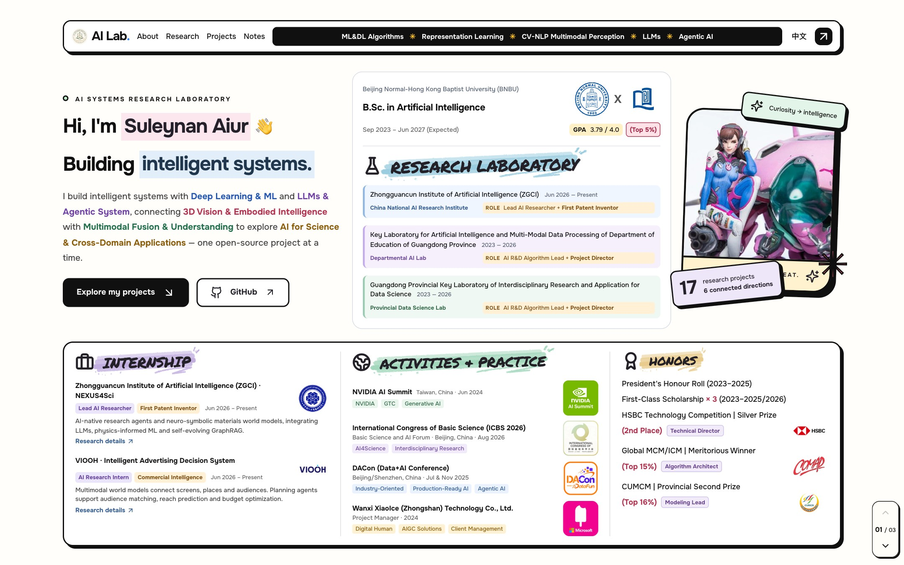
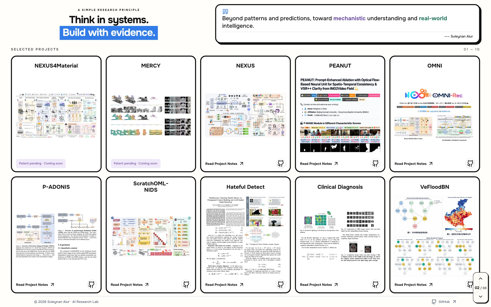
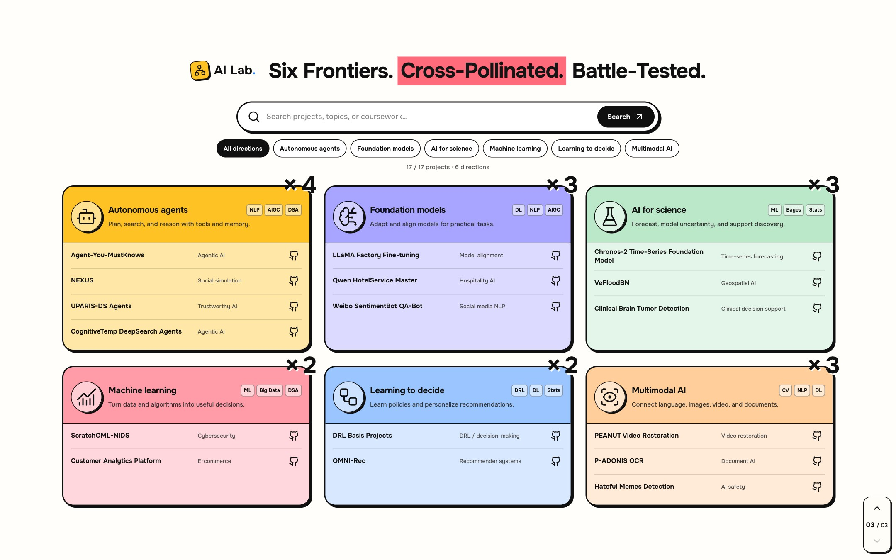
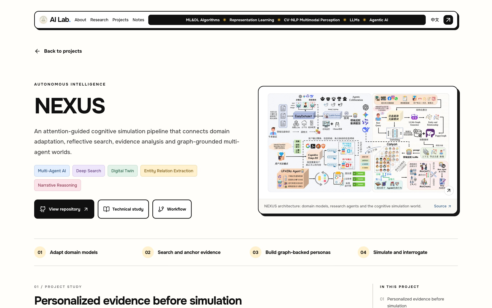
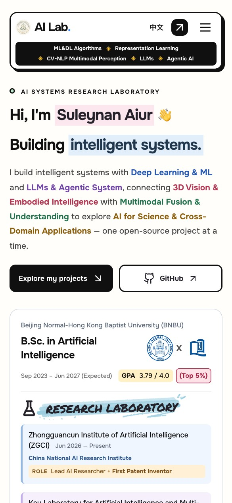

# Suleynan Aiur · AI Research Lab

**Think in systems. Build with evidence.**

个人 AI 研究作品集，展示研究经历、六个研究方向和 17 个项目的技术实践。网站采用中英文双语、分屏导航和图文项目详情，通过 GitHub Pages 静态部署。

**[访问网站 →](https://suleynanauir.github.io/portfolio/)** · [中文入口](https://suleynanauir.github.io/portfolio/zh/) · [项目详情示例](https://suleynanauir.github.io/portfolio/projects/nexus/) · [部署记录](https://github.com/SuleynanAuir/portfolio/actions/workflows/pages.yml)

> Beyond patterns and predictions, toward mechanistic understanding and real-world intelligence. — Suleynan Aiur

## 网页效果

以下为当前网站的实际截图。桌面端按「个人介绍 → 推荐项目 → 研究方向」分屏浏览；手机端使用适合阅读的滚动布局。

### 01 · 个人介绍与研究经历

教育背景、研究实验室、实习、活动与荣誉集中展示；彩色标记突出研究角色、奖项和技术方向。

[](https://suleynanauir.github.io/portfolio/)

### 02 · 推荐项目

十张项目卡片采用统一图片区域，支持查看高清大图、进入项目详情及访问 GitHub 仓库。NEXUS4Material 与 MERCY 标注为专利申请中、尚未上线。

[](https://suleynanauir.github.io/portfolio/#notes)

### 03 · 六个研究方向

Autonomous Agents、Foundation Models、AI for Science、Machine Learning、Learning to Decide（强化学习与推荐）及 Multimodal AI。研究方向卡片连接项目浏览与筛选界面。

[](https://suleynanauir.github.io/portfolio/#research)

### 项目详情 · 方法、证据与实现

以 NEXUS 为例：左侧介绍、右侧代表图，结合彩色技术标签、工作流程、正文配图、实现参数及仓库来源，呈现项目的技术思路。

[](https://suleynanauir.github.io/portfolio/projects/nexus/)

<details>
<summary>查看手机端效果</summary>

<br />


手机端自动调整列数和文字布局，保持内容完整可读；项目图片可点击打开大图。

</details>

## 功能与内容

- **双语浏览**：英文与中文界面，切换语言时保留当前页面路径。
- **三屏首页**：个人介绍、十个推荐项目、六个研究方向；桌面推荐项目页按视口高度排列两行卡片。
- **项目研究详情**：17 个项目，依据 18 个仓库 README 整理概览、方法、实现参数、评估背景与复现信息；DRL v1/v2 合并呈现。
- **项目检索**：按研究方向筛选、关键词搜索，并链接到独立详情页和 GitHub 仓库。
- **研究经历**：实验室角色与任职时间、实习展开详情、活动标签及荣誉角色。
- **可感知的翻页**：方向性滑动、淡入和顶部进度条，尊重系统的 `prefers-reduced-motion` 设置。
- **静态与本地资源**：本地字体、WebP 图片、独立详情 URL、站点地图与 GitHub Pages 自动部署。

项目介绍区分已实现内容、README 报告的实验结果与后续计划；实验数值保留其数据集和评估背景。部分原始笔记和外部学习资料保留原文。

## 技术栈

| 层级 | 实现 |
| --- | --- |
| 应用框架 | Next.js 15 App Router、React 19、TypeScript |
| 样式与图标 | CSS、Tailwind CSS 4、Lucide React |
| 内容 | TypeScript 数据、JSON 研究资料、Markdown 项目笔记 |
| 图片处理 | Sharp、WebP 优化、原始图示 |
| 动画 | Web Animations API、IntersectionObserver |
| 部署 | Next.js 静态导出、GitHub Actions、GitHub Pages |

## 本地运行

使用 **Node.js 22** 与 npm（与部署工作流一致）：

```bash
npm ci
npm run dev
```

- 英文首页：<http://localhost:3000/>
- 中文首页：<http://localhost:3000/zh/>
- 项目目录：`/projects/`、`/zh/projects/`
- 笔记目录：`/notes/`、`/zh/notes/`

检查与生产预览：

```bash
npm run lint       # ESLint
npm run typecheck  # TypeScript；首次可先执行 build 生成 Next.js 类型
npm run build      # 优化图片、构建并导出静态页面
npm start          # 预览 out/，自动读取构建时的路径前缀
```

默认生产预览地址为 <http://localhost:3000/portfolio/>。开发模式使用根路径，生产构建默认使用 `/portfolio` 前缀。

## 内容维护

| 文件或目录 | 用途 |
| --- | --- |
| `components/home-page.tsx` | 首页三屏及其顺序 |
| `components/featured-projects.tsx` | 推荐项目名称、顺序、图片和入口 |
| `components/page-transitions.tsx` | 分屏导航与页面到达动画 |
| `data/profile.ts` | 教育、实验室、实习、活动、荣誉和研究主题 |
| `data/portfolio.ts` | 六个研究方向与项目基础信息 |
| `data/project-studies.json` | 中英文项目详情、工作流程、技术参数与配图 |
| `data/project-readme-sources.json` | README 来源及采集记录 |
| `data/project-image-sources.json` | 项目图片来源与尺寸 |
| `data/site-copy.ts` | 双语文案与项目显示内容 |
| `content/projects/` | Markdown 项目笔记 |
| `lib/site-config.ts` | 站点信息、资源前缀与旧项目 URL 映射 |
| `assets/proj_logo/` | 推荐项目图片原始文件 |
| `public/assets/proj_logo/` | 网页使用的高清 WebP 项目图片 |
| `public/assets/projects/` | 项目详情的架构图、流程图与实验图 |
| `public/assets/organizations/` | 学术机构、活动及荣誉标识 |
| `public/assets/web_page/`、`public/assets/optimized/` | 原始网站图像与优化版本 |
| `public/fonts/` | 本地字体与对应许可证 |
| `app/globals.css` | 页面配色、响应式布局与交互样式 |
| `docs/images/` | 本 README 使用的网站截图 |

`npm run optimize:images` 处理 `public/assets/web_page/` 中的图片，开发与构建前会自动执行。更新推荐项目图片时，还需同步 `public/assets/proj_logo/` 中对应的 WebP 文件；该目录不由上述脚本自动生成。

网站运行不依赖本地参考项目 `cvweb/`。原有 `/asrl_agent_ml_dl_cv_nlp/`、中文对应路径及项目别名仍保留兼容入口。

## GitHub Pages 部署

正式地址：**https://suleynanauir.github.io/portfolio/**

工作流：[`.github/workflows/pages.yml`](.github/workflows/pages.yml)

1. 在仓库 **Settings → Pages → Build and deployment → Source** 选择 **GitHub Actions**。
2. 将修改推送到 `main`，或在 Actions 中手动运行 **Deploy portfolio to GitHub Pages**。
3. 工作流安装依赖、执行 lint、构建网站、上传 `out/` 并部署；成功后可从 `github-pages` 环境访问网站。

工作流从 GitHub Pages 配置读取 `base_path` 与 `base_url`，统一资源路径、语言切换、元数据和站点地图。线上无需 Node.js 服务器，也无需将 `out/` 提交到源码仓库。

部署到其他仓库或域名时，需重新构建对应的路径前缀：

```bash
# GitHub 项目站点
NEXT_PUBLIC_BASE_PATH=/another-repo \
NEXT_PUBLIC_SITE_URL=https://example.github.io/another-repo \
npm run build

# 根域名
NEXT_PUBLIC_BASE_PATH= \
NEXT_PUBLIC_SITE_URL=https://example.com \
npm run build
```

`out/` 中包含 `.nojekyll`、`404.html`、`sitemap.xml`、`robots.txt` 和本地预览所需的 `deployment.json`。

## 资源说明

项目图示保留仓库来源，正文中可访问对应参考链接。机构与活动标识用于说明相关经历；本地字体的许可文本随文件保存在 `public/fonts/`。README 截图存放在仓库内，便于随页面更新同步维护。
